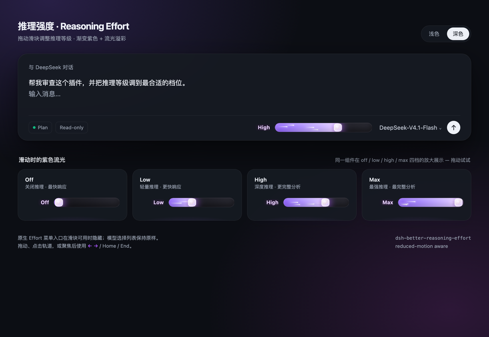
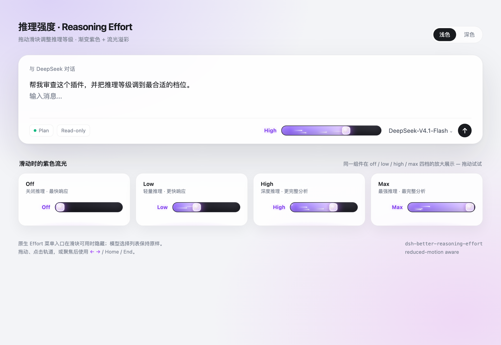

# dsh-better-reasoning-effort

A reasoning-effort slider for the DeepSeek Harness Web GUI. It replaces the effort dropdown with a control in the composer: the current level on the left, the slider on the right.

The selected part is a light violet gradient; the rest of the rail is grey-black. The level updates while you drag. Model routing, session data, and request parameters are untouched.





## What it does

- Shows only the current level on the left, capitalized: `Off`, `Low`, `High`, `Max`.
- A 220px rail, with the whole control 24px tall.
- Drag the thumb, click the rail, or use `←` `→` `↑` `↓` `Home` `End`.
- The selected part is a light violet gradient; the rest is grey-black. Meteors stay inside the selected part.
- Higher levels make the sheen, meteors, and glow move faster.
- Hides the native effort caption and menu entry; the model list stays intact.
- Falls back to the native picker when the model has no reasoning levels.
- Light/dark themes, `prefers-reduced-motion`, and `forced-colors`.

## Install

Point `dsh plugin` at this checkout:

```sh
dsh plugin --profile desktop add /path/to/dsh-better-reasoning-effort
```

Or with the desktop CLI:

```sh
"/Applications/DeepSeek Harness.app/Contents/Resources/runtime/cli/bin/dsh" \
  plugin --profile desktop add /path/to/dsh-better-reasoning-effort
```

If the running page does not show the slider immediately, refresh it; if it still does not appear, fully quit and reopen DeepSeek Harness.

The profile installs a local link; if this directory moves, reinstall.

## Use

- Drag the thumb, click the rail, or focus and use `←` `→` `↑` `↓` `Home` `End`.
- The left label shows only the current level, with the first letter capitalized.
- While the slider is usable, the model button shows only the model name and the model menu keeps only model selection.

## Uninstall

```sh
dsh plugin --profile desktop remove dsh-better-reasoning-effort
```

Then restart the app. Disposal removes the stylesheet and slot contribution; it does not touch models, sessions, or user data.

## How it works

1. Register a React component in the `conversation.input.right` list slot.
2. In the slot's `inject(sessionId)`, resolve `ctx.modelDirectories.directoryFor(sessionId)` and subscribe to the session directory.
3. Build stops from `groups → model.reasoning.efforts`; add a provider-default stop when `defaultEffort` is undefined.
4. Submit through `directory.select({ provider, model, reasoningEffort })`, the same `session.selectModel` path used by the native picker and `/model`.
5. `activeIndex` drives the left label and updates during dragging; `capitalizeFirst` capitalizes only the first letter.
6. While usable, mark `<body data-rls-effort-slider>`; CSS hides the native effort caption and uses a scoped `:has(...)` rule to hide the model menu's Effort entry on the first paint.
7. Fiber disposal removes styles, DOM marks, subscriptions, and the slot contribution.

## Animation details

- The fill uses a two-color oklab interpolation across its current width; its color distribution does not change with the level. The fill itself does not translate; the loop comes from the sheen, meteors, and glow.
- Six meteor trails live inside the fill layer and travel from outside its left edge to outside its right edge. The fill clips them, so the grey-black remainder has no white meteors.
- The sheen starts and ends outside the rail.
- CSS durations are driven by `--rls-pos` (0–1), so meteors, sheen, and glow become more urgent at higher levels.
- `prefers-reduced-motion` disables every loop; `forced-colors` uses system colors.

## Customization

Track size and motion constants live at the top of `src/plugin.css`:

```css
--rls-track-h: 22px;
--rls-thumb-size: 18px;
--rls-inset: 11px;
```

The fill uses the lighter oklab ramp `#8b5cf6 → #e9d5ff`. The rail is 220px by default and narrows through `@container` rules.

## Development

The runtime has no dependencies; `react` and `react-dom` are development dependencies for the browser tests and preview. The host supplies React at runtime.

```sh
npm install
npm run build
npm test
npm run preview
```

The browser test covers slot registration, the single capitalized current level, the removed level-labels row, the 24px control and 22px rail, the transparent-at-rest border, the longer rail, the grey-black remainder, the static even gradient, six meteors clipped to the fill, the rounded-square thumb, keyboard/pointer selection, no-reasoning fallback, the provider-default stop, first-paint menu hiding, and full cleanup.

## Publishing and installing on another device

Short version:

```sh
# Build a tarball on this machine
npm pack --pack-destination dist

# On the other device
dsh plugin --profile desktop add /path/to/dsh-better-reasoning-effort-0.4.0.tgz
```

The unscoped npm name `dsh-better-reasoning-effort` is already taken. To publish to npm, use a scope (for example `@your-name/dsh-better-reasoning-effort`) and update the `name` in `cordis.patch.yml` too. GitHub installs use `dsh plugin --profile desktop add github:<owner>/<repo>`. See [`PUBLISHING.md`](PUBLISHING.md) for the full checklist, scoped-package renaming, `prepare`/`allowBuilds`, and verification steps.

## Limitations

- Written against DeepSeek Harness `0.2.1-rc.2`.
- Level names come from the adapter; `capitalizeFirst` only affects display.
- The native Effort menu entry is hidden while the slider is usable; remove the two `data-rls-effort-slider` rules at the top of `src/plugin.css` to keep it.
- Visual and interaction layer only: it never changes model routing, request parameters, or session data.

## License

Apache-2.0
